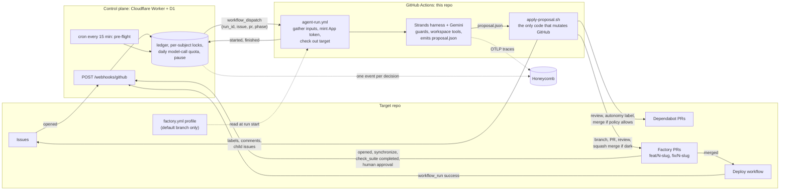

# software-factory

An autonomous software factory that takes a target repository from issue to merged, deployed and verified change. LLM agents run in a zero-trust sandbox and can only *propose*; deterministic, unit-tested pipelines decide and act. A Cloudflare Worker + D1 control plane owns dispatch, locks, quota and the kill switch, and every run and decision is observable in Honeycomb through a board defined as code.

- **Live control plane dashboard:** <https://factory-control-plane.nimeshjm.workers.dev/dashboard>
- **Public Honeycomb board:** <https://ui.eu1.honeycomb.io/nimeshjm-personal/environments/software-factory/board/x9-5VWLvd5Ju>
- **Example merged factory PRs:** [#131 bug fix, Dream Team response shape](https://github.com/nimeshjm/fantasy-football/pull/131) · [#129 feature, revised once then approved](https://github.com/nimeshjm/fantasy-football/pull/129) · [#126 security fix, stack-trace exposure](https://github.com/nimeshjm/fantasy-football/pull/126) · [#105 docs change, merged lights-off](https://github.com/nimeshjm/fantasy-football/pull/105)

**Production snapshot (30 days to 2026-11-22):** 4 of 4 factory-authored PRs merged (1 dark, 3 lit with human approval), 3 of 4 on the first pass (one needed its `revise` round) | 7 of 8 Dependabot bumps merged by the factory | 577 agent runs, 94% successful | 2,264 model calls, about 75 a day against a 400/day quota | free-tier infrastructure <!-- Sources: GitHub PR search on the target (PRs); Honeycomb `factory` dataset, run.finished events (runs, calls). TODO: avg model calls per merged PR once pr.closed events reach Honeycomb (panels 15-pr-acceptance, 16-pr-outcomes are empty: no pr.closed events in this window). -->

## Core architectural bets

| Bet | How it is enforced |
|---|---|
| **Zero-trust agent sandbox: agents propose, pipelines act** | The agent process holds only its Gemini keys (`GEMINI_API_KEY`, plus an optional free-tier `GEMINI_FREE_API_KEY` used first), a read-only Honeycomb query key for the incident responder and a Tavily key for builder/bug-fixer (read inside their tools and never exported to shell). It emits a schema-validated `proposal.json`; `scripts/apply-proposal.sh`, under a short-lived GitHub App token, is the only code that mutates GitHub, and it applies policy first. No agent holds a GitHub, Cloudflare or smoke-test token. |
| **Deterministic control plane** | A Cloudflare Worker + D1 owns webhooks, a 15-minute pre-flight cron, per-subject locks, a daily model-call quota, per-subject exponential failure backoff (1 h, 3 h, then a 24 h `failure-cap`), backpressure on open factory PRs, and a kill switch (`/admin/pause`). Policy is pure, unit-tested code (`factory/policy/`, `control-plane/src/preflight.ts`). |
| **Graduated autonomy and governance** | A PR is `autonomy:dark` (merges on green CI with all threads resolved) only if every changed path is inside the target's `dark_paths` (or, with `dark_dependency_bumps: true`, is a Dependabot bump confined to `toolchain.dependency_files` and outside `lit_dependencies`); anything else is `autonomy:lit` and merges only on approval from a human named in the target's `amigos` (the Three Amigos contract). `risk:high` work stops at the plan until a human adds `plan:approved`, and plans that set `needs_human` or touch protected paths always hold. A reviewer's `request_changes` gets exactly one bounded `revise` attempt, then `needs-human`. |
| **Unit economics and model resilience** | Runs on free tiers (GitHub Actions, Cloudflare, Honeycomb, and Gemini first), with a billing-linked Gemini key as overflow under a daily paid budget the control plane hands out per run. Tiered model routing (cheap / strong / spike keys), automatic fallback chains on daily-quota 429s and on unresponsive or stalled streams, and `BudgetGuard`, which nudges the agent and reserves a finalization turn to commit and emit a proposal before a phase exhausts its token, turn or call budget (with `scripts/salvage-run.sh` backing up uncommitted work if it still fails). |

## System flow

| Role | Human owns | Agent executes |
|---|---|---|
| Product (intent) | Issues, the product spec, `plan:approved` on `risk:high` | Architect: research and plan phases |
| Development (direction) | `.agents/*`, `factory.yml`, approves `autonomy:lit` PRs | Builder / bug-fixer: implement against the plan |
| Testing (coherence) | "Questions for the human" in reviews, smoke checks | Reviewer, verifier, incident-responder, security-triage |

The boundary between the two trios, the gates that enforce it and where each lives in code are in [`docs/three-amigos.md`](docs/three-amigos.md).



Loops the cron and webhooks drive: triage on any unlabeled issue; builder on `status:backlog` features and enhancements and bug-fixer on backlog bugs, both posting the plan first and stopping there (`status:plan-review`) on the profile's `plan_review.hold_on` labels (`risk:high` by default), protected paths, or when the plan needs a human, resuming with `implement` once a human adds `plan:approved` (label holds only); reviewer on every factory PR event, on a human approval of any PR, and hourly on the oldest open Dependabot PR; verifier after each successful target deploy; incident responder once a day; security triage once a day and on GitHub security alert webhooks.

## Production lessons and hardening

Each row is a failure observed in production and the structural fix it produced; details are in [`CONTRACTS.md`](CONTRACTS.md) and [`docs/history.md`](docs/history.md).

| Incident / failure mode | Structural fix |
|---|---|
| **Issue #125 run (2026-11-12):** builder spent 42 calls and 922k tokens with checks passing, then died on `limit_total_tokens` with nothing pushed. | `BudgetGuard`: a soft nudge at 85% of the token, turn or call cap, a reserved `FINALIZE_PROMPT` invocation that commits and emits a proposal, plus `scripts/salvage-run.sh`, which pushes any half-done implement work to a `backup/*` branch. |
| **2026-11-22:** the hourly Dependabot cron re-reviewed the same unchanged head 16 times (~50 calls, 1.2M tokens), every review discarded. | Deterministic `reuse-review` pre-check in `scripts/run-phases.sh`: an unchanged Dependabot head reuses the posted verdict with zero model calls. |
| **Issue #107 runs (2026-11-12):** six throttled calls, zero tokens, 23 minutes of job timeout burned on a hanging model. | `first_event_timeout_s` stall detection and `unresponsive_switch_after` fallback in `FactoryGeminiModel`: two consecutive unresponsive requests switch to the next model in the chain. |
| **Before 2026-11-13:** GitHub answered 422 to `REQUEST_CHANGES` on factory-authored PRs, costing two failed attempts per review. | `post_review` routes factory-authored PRs straight to a `COMMENT` event, with the verdict on the body's first line. |
| **2026-10-29, first spikes:** findings claimed HTTP statuses the agent never received, or were written from memory. | Spike findings are posted only if at least one real fetch happened and `check-findings` matches every claimed status to a fetch in that section; the pipeline appends its own `## Evidence` list of every fetch and search. |
| **2026-10-29:** a 1.1 MB JSON response was clipped at 20k chars, so the agent reported a field as absent that sat at char 36k. | `fetch_url` reads JSON up to 2 MB and leads with an indented key tree of the whole body; every cut is marked `[clipped: ...]`, so "absent" is only claimed when the whole body was seen (prompt rule). |
| **2026-10-28:** a research spike correctly proposed no file changes and failed at apply ("no commits ahead of main"): the only delivery path was a PR. | A spike delivers `findings_md` as an issue comment and closes the issue; `files == []` without findings still fails the run. |

## Platform pattern and scaling

**Decoupled target contract.** The target is named in `factory.config.json#target`. Each target describes itself in a `factory.yml` on its default branch: toolchain and checks, protected and `dark_paths`, risk rules, secrets the agent must never see, smoke checks, and its human `amigos`. The factory core reads only that profile, and `tests/test_no_target_leaks.py` fails CI if target-specific names appear in `factory/` or `agents/`. Onboarding a new repo is a copy of `templates/target/` plus a few secrets ([`docs/SETUP.md`](docs/SETUP.md#onboarding-a-target)).

**Hard ceilings on cost and blast radius.** `limits.max_diff_lines` (300) and `max_diff_files` (8) cap what any PR can merge, and `quota.max_open_factory_prs` (3) bounds open factory PRs; `limits.max_context_chars` (60k) caps the context inlined into every prompt and fails the run before any model call when exceeded; `quota.daily_model_calls` (400) caps model spend across all agents, with each run reserving its calls before dispatch.

**What breaks at 100x.**
- `workflow_dispatch` on shared GitHub Actions runners adds queue latency and concurrency limits → dedicated ephemeral runners fed from a job queue.
- One D1 ledger holds every lock, quota and decision → per-tenant sharding (a Durable Object or D1 database per target).
- A static `factory.yml` per repo makes org-wide policy changes N pull requests → a central policy registry with per-repo overrides.
- Free-tier per-model daily quotas cap throughput → provisioned throughput and multi-provider routing behind the same fallback chains.
- All webhooks fan in to one Worker and one cron tick → an event bus with per-tenant backpressure and fair scheduling.

## Repository layout

```
factory/           Python harness (guards, tools, policy, schemas)
agents/            system prompts
scripts/           apply-proposal.sh and friends (see scripts/README.md)
smoke/             Playwright smoke test driven by the target profile
control-plane/     Cloudflare Worker
templates/target/  starter factory.yml, .agents/*.md and onboarding for a new target
examples/          worked example profile of an onboarded target (see examples/README.md)
.github/workflows/ agent-run.yml (reusable), one wrapper per agent, ci.yml
factory.config.json, CONTRACTS.md
```

## Documentation

- [`docs/SETUP.md`](docs/SETUP.md): onboarding a target, secrets and variables, GitHub App, running wrappers, graduation, pause/resume, Honeycomb board
- [`CONTRACTS.md`](CONTRACTS.md): schemas, policy rules, labels, telemetry fields, control-plane HTTP
- [`docs/three-amigos.md`](docs/three-amigos.md): the human/agent boundary and the gates that enforce it
- [`control-plane/README.md`](control-plane/README.md): Worker deployment, `GET /status` and dashboard fields
- [`scripts/README.md`](scripts/README.md): the post-step scripts
- [`docs/history.md`](docs/history.md): early build and graduation log
