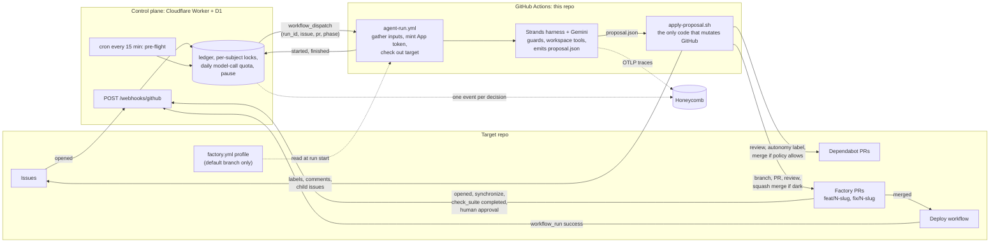

# software-factory

An autonomous software factory for one target repository, named in `factory.config.json#target`. The target describes its own toolchain, protected paths, risk rules and smoke checks in a `factory.yml` profile on its default branch (see the Target profile section of `CONTRACTS.md` and `templates/target/`). Intent and production signals feed a queue; Strands agents (Gemini free tier) run in GitHub Actions and emit structured proposals; deterministic post-steps apply them (labels, comments, PRs, merges); a free-tier Cloudflare Worker is the control plane (pre-flight, locks, quota, kill switch). Agents propose, pipelines act: no agent process holds a GitHub, Cloudflare or smoke-test token.

| Role | Human owns | Agent executes |
|---|---|---|
| Product (intent) | Issues, the product spec, `plan:approved` on `risk:high` | Architect: research and plan phases |
| Development (direction) | `.agents/*`, `factory.yml`, approves `autonomy:lit` PRs | Builder / bug-fixer: implement against the plan |
| Testing (coherence) | "Questions for the human" in reviews, smoke checks | Reviewer, verifier, incident-responder |

The boundary between the two trios, the gates that enforce it and where each lives in code are in `docs/three-amigos.md`. The humans are named per target in `factory.yml` `amigos`; the pipeline addresses them on plan and review comments and only a named amigo's approval merges a lit PR.

## How it flows



Loops the cron and webhooks drive: triage on any unlabeled issue; builder on `status:backlog` features and enhancements and bug-fixer on backlog bugs, both posting the plan first and stopping there (`status:plan-review`) on the profile's `plan_review.hold_on` labels (`risk:high` by default) or when the plan needs a human, resuming with `implement` once a human adds `plan:approved`; reviewer on every factory PR event, on a human approval of any PR, and hourly on the oldest open Dependabot PR; verifier after each successful target deploy; incident responder once a day. The agent process holds only the Gemini key. Everything that touches GitHub runs in `apply-proposal.sh` under a freshly minted App token, and a PR merges without a human only when it is confined to the profile's `dark_paths` (or, with `dark_dependency_bumps: true`, is a Dependabot bump confined to `toolchain.dependency_files` and outside `lit_dependencies`), CI is green and every review thread is resolved.

## Layout

```
factory/           Python harness (guards, tools, policy, schemas)
agents/            system prompts
scripts/           apply-proposal.sh and friends (see scripts/README.md)
smoke/             Playwright smoke test driven by the target profile
control-plane/     Cloudflare Worker
templates/target/  starter factory.yml, .agents/*.md and onboarding for a new target
examples/          worked example profiles (examples/fantasy-football)
.github/workflows/ agent-run.yml (reusable), one wrapper per agent, ci.yml
factory.config.json, CONTRACTS.md
```

## Onboarding a target

Copy `templates/target/` into the target repo (`factory.yml`, `.agents/*.md`, `docs/product-spec.md`, issue and PR templates) and follow its `ONBOARDING.md`. `examples/fantasy-football/` is a filled-in profile for a Cloudflare Worker app. The profile is read from the default branch only; a missing or invalid `factory.yml` fails the run before any model call. Its `web.allowed_hosts` list (empty by default; `["*"]` = any public host) turns on web research for the builder and bug-fixer: it names the hosts `fetch_url` may read and enables spike delivery, and `web_search` also needs `TAVILY_API_KEY`.

## Secrets and variables

This repo, Actions secrets: `GEMINI_API_KEY`, `FACTORY_APP_ID`, `FACTORY_APP_PRIVATE_KEY` (the original PKCS#1 PEM), `HONEYCOMB_API_KEY` (ingest), `HONEYCOMB_QUERY_KEY` (read), `SMOKE_AUTH_TOKEN` (value for the header named by `smoke.version.auth_header`; optional), `FACTORY_TOKEN`, `TAVILY_API_KEY` (optional; Tavily free tier, 1,000 searches/month, no card; powers `web_search` for builder and bug-fixer).
This repo, Actions variables: `FACTORY_URL` (control plane URL), `TARGET_BASE_URL` (deployed target, no trailing slash).
Control plane (`wrangler secret put`): App id, App private key as **PKCS#8**, `GITHUB_WEBHOOK_SECRET`, `FACTORY_TOKEN`, `HONEYCOMB_API_KEY`, `ALERT_WEBHOOK_URL`.
Keep Gemini on a dedicated Google Cloud project so AI Studio shows the factory's quota alone.

## GitHub App

1. Settings, Developer settings, GitHub Apps, New: name `factory.config.json#factory.app_slug` (currently `software-factory-agent-bot`), webhook off (the Worker receives repo webhooks separately).
2. Repository permissions: Contents RW, Issues RW, Pull requests RW, Actions RW, Checks R, Metadata R. No Workflows permission.
3. Generate a private key, install the App on the target repo and this repo, store the App id and key as secrets above.
4. Worker key conversion (WebCrypto needs PKCS#8):
   `openssl pkcs8 -topk8 -nocrypt -in software-factory-agent-bot.<date>.private-key.pem -out factory-bot.pkcs8.pem`
5. Run `GH_TOKEN=<token> scripts/preflight-labels.sh` once to create the label set on the target.

## Running wrappers manually

```
gh workflow run triage.yml -f issue=35 -f dry_run=true
gh workflow run builder.yml -f issue=12 -f dry_run=true          # research, plan, implement
gh workflow run builder.yml -f issue=12 -f phase=plan -f dry_run=true
gh workflow run bug-fixer.yml -f issue=14 -f dry_run=true
gh workflow run reviewer.yml -f pr=40 -f dry_run=true
gh workflow run verifier.yml -f pr=40 -f dry_run=true
gh workflow run incident-responder.yml -f dry_run=true
gh workflow run security-triage.yml -f dry_run=true
```
`dry_run=true` runs the model and prints the proposal; nothing is applied. Artifacts (`out/**`) are kept for one day.

## Graduation order

All wrappers with `dry_run=true`, then `dry_run=false`, then control-plane dispatch. Order: triage, reviewer on Dependabot PRs, verifier, builder on a `risk:low size:S` issue, bug-fixer, incident responder (once product telemetry exists), security triage (needs the App's code scanning, Dependabot and secret scanning alerts read permissions). Dark merging stays limited to the profile's `dark_paths`; widen `factory.yml` only after five clean lit merges per path group.

## Pause

`curl -X POST -H "Authorization: Bearer $FACTORY_TOKEN" $FACTORY_URL/admin/pause` stops dispatch within one tick; `/admin/resume` restarts it. `GET /status` shows quota, in-flight runs and every decision of the last tick, including why each backlog issue was skipped; the fields and skip reasons are documented in `control-plane/README.md`.

## Honeycomb board

Board link: _to be filled by the owner after the first run of `scripts/honeycomb-board.sh` (it prints `board: <url>` and writes the id to `docs/honeycomb/board.json`)._

The board answers "are the agents' runs healthy?" from two Honeycomb datasets in the EU environment, last 7 days: `factory` (control-plane events: run panels, panels 01-05, 09, 12) and `software-factory` (the harness's OTLP spans and span events: panels 06-08, 10, 11; the two cannot be joined), with `agent` and `dry_run` as board filters. It is code: `docs/honeycomb/derived_columns.json`, `docs/honeycomb/panels/*.json` (one saved query, annotation and panel each) and `docs/honeycomb/board.json`; the event fields are in `CONTRACTS.md` under "Honeycomb events".

Apply it (owner only, never from Actions): `HONEYCOMB_CONFIG_KEY=<key> scripts/honeycomb-board.sh`, with a Honeycomb configuration key that has "Manage Queries and Columns" and "Manage Public Boards" (keep it out of the repo and out of Actions secrets). It first lists each dataset's columns and skips, with a warning naming the missing columns, every derived column, panel and board filter that needs a column that does not exist yet (Honeycomb only knows a column once an event has carried it). So the first run after a deploy gives a partial board, and `applied N of M panels` says which are missing; re-run later to fill it in (with no applicable panel it leaves the board alone). It then upserts the derived columns by alias, creates fresh queries and annotations, then creates the board (first run: commit the id it writes to `board.json`) or replaces it and deletes the previous annotations. `scripts/honeycomb-board.sh --dry-run` prints every request without a key and without calling the API.

| Panel file | Shows | Reads |
|---|---|---|
| `01-run-outcomes` | runs per day by `agent_d`, stacked by `status` | `run.finished`: `agent_d`, `status` |
| `02-where-runs-die` | table of runs with `status` failed, timeout, lost or denied | `run.finished`: `run_id`, `agent_d`, `subject`, `phase`, `stop_reason`, `error`, `workflow_run_url`, `status` |
| `03-stop-reasons` | stop reasons by agent | `run.finished`: `agent_d`, `stop_reason` |
| `04-run-time` | P50/P95 run time, P95 queue time | `run.finished`: `duration_s`, `queue_s` |
| `05-model-calls-vs-cap` | heatmap of model calls, daily max of calls/reservation | `run.finished`: `model_calls`, `calls_ratio` (derived from `reserved_calls`) |
| `06-tokens` | input and output tokens per agent, phase, model | model spans: `gen_ai.usage.input_tokens`, `gen_ai.usage.output_tokens`, `factory.agent`, `factory.phase`, `factory.model_id` |
| `07-model-switches` | fallbacks by from, to, reason | span event `factory.model_switch`: `factory.model.from`, `.to`, `.reason` |
| `08-model-retries` | throttles, stalls, 5xx per day | span event `factory.model_retry`: `factory.agent`, `factory.retry.reason`, `factory.model_id` |
| `09-throttles` | throttles per agent | `run.finished`: `throttles` |
| `10-tool-guard-blocked` | denied tool calls | span event `tool_guard.blocked`: `factory.agent`, `rule` |
| `11-guard-events` | other guard events | span events named `*.event`: `guard`, `rule` |
| `12-lost-runs` | runs marked lost by the tick | `run.finished` with `status = lost`: `agent_d` |

`agent_d` is a derived column on `factory`: `agent`, else parsed from `run_id` (so events from before the `agent` field exist still group by agent).
