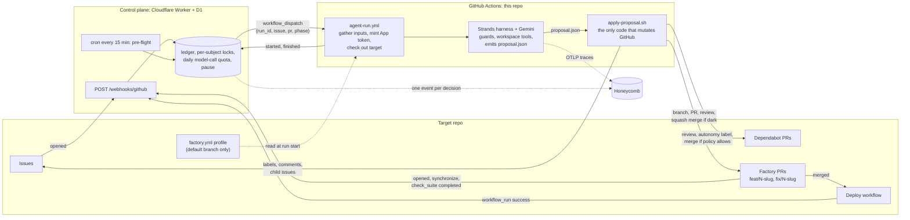

# software-factory

An autonomous software factory for one target repository, named in `factory.config.json#target`. The target describes its own toolchain, protected paths, risk rules and smoke checks in a `factory.yml` profile on its default branch (see the Target profile section of `CONTRACTS.md` and `templates/target/`). Intent and production signals feed a queue; Strands agents (Gemini free tier) run in GitHub Actions and emit structured proposals; deterministic post-steps apply them (labels, comments, PRs, merges); a free-tier Cloudflare Worker is the control plane (pre-flight, locks, quota, kill switch). Agents propose, pipelines act: no agent process holds a GitHub, Cloudflare or smoke-test token.

| Role | Human owns | Agent executes |
|---|---|---|
| Product (intent) | Issues, the product spec, `plan:approved` on `risk:high` | Architect: research and plan phases |
| Development (direction) | `.agents/*`, `factory.yml`, approves `autonomy:lit` PRs | Builder / bug-fixer: implement against the plan |
| Testing (coherence) | "Questions for the human" in reviews, smoke checks | Reviewer, verifier, incident-responder |

## How it flows



Loops the cron and webhooks drive: triage on any unlabeled issue; builder on `status:backlog` features and enhancements and bug-fixer on backlog bugs, both stopping after the plan on `risk:high` until a human adds `plan:approved`; reviewer on every factory PR event and hourly on the oldest open Dependabot PR; verifier after each successful target deploy; incident responder once a day. The agent process holds only the Gemini key. Everything that touches GitHub runs in `apply-proposal.sh` under a freshly minted App token, and a PR merges without a human only when it is confined to the profile's `dark_paths` (or, with `dark_dependency_bumps: true`, is a Dependabot bump confined to `toolchain.dependency_files` and outside `lit_dependencies`), CI is green and every review thread is resolved.

## Layout

```
factory/           Python harness (guards, tools, policy, schemas)
agents/            system prompts
scripts/           apply-proposal.sh and friends (see scripts/README.md)
smoke/             Playwright smoke test driven by the target profile
control-plane/     Cloudflare Worker
templates/target/  starter factory.yml, .agents/*.md and onboarding for a new target
examples/          worked example profiles (examples/fantasy-football)
.github/workflows/ agent-run.yml (reusable), one wrapper per agent, ci.yml
factory.config.json, CONTRACTS.md
```

## Onboarding a target

Copy `templates/target/` into the target repo (`factory.yml`, `.agents/*.md`, `docs/product-spec.md`, issue and PR templates) and follow its `ONBOARDING.md`. `examples/fantasy-football/` is a filled-in profile for a Cloudflare Worker app. The profile is read from the default branch only; a missing or invalid `factory.yml` fails the run before any model call. Its `web.allowed_hosts` list (empty by default; `["*"]` = any public host) turns on web research for the builder and bug-fixer: it names the hosts `fetch_url` may read and enables spike delivery, and `web_search` also needs `TAVILY_API_KEY`.

## Secrets and variables

This repo, Actions secrets: `GEMINI_API_KEY`, `FACTORY_APP_ID`, `FACTORY_APP_PRIVATE_KEY` (the original PKCS#1 PEM), `HONEYCOMB_API_KEY` (ingest), `HONEYCOMB_QUERY_KEY` (read), `SMOKE_AUTH_TOKEN` (value for the header named by `smoke.version.auth_header`; optional), `FACTORY_TOKEN`, `TAVILY_API_KEY` (optional; Tavily free tier, 1,000 searches/month, no card; powers `web_search` for builder and bug-fixer).
This repo, Actions variables: `FACTORY_URL` (control plane URL), `TARGET_BASE_URL` (deployed target, no trailing slash).
Control plane (`wrangler secret put`): App id, App private key as **PKCS#8**, `GITHUB_WEBHOOK_SECRET`, `FACTORY_TOKEN`, `HONEYCOMB_API_KEY`, `ALERT_WEBHOOK_URL`.
Keep Gemini on a dedicated Google Cloud project so AI Studio shows the factory's quota alone.

## GitHub App

1. Settings, Developer settings, GitHub Apps, New: name `factory.config.json#factory.app_slug` (currently `software-factory-agent-bot`), webhook off (the Worker receives repo webhooks separately).
2. Repository permissions: Contents RW, Issues RW, Pull requests RW, Actions RW, Checks R, Metadata R. No Workflows permission.
3. Generate a private key, install the App on the target repo and this repo, store the App id and key as secrets above.
4. Worker key conversion (WebCrypto needs PKCS#8):
   `openssl pkcs8 -topk8 -nocrypt -in software-factory-agent-bot.<date>.private-key.pem -out factory-bot.pkcs8.pem`
5. Run `GH_TOKEN=<token> scripts/preflight-labels.sh` once to create the label set on the target.

## Running wrappers manually

```
gh workflow run triage.yml -f issue=35 -f dry_run=true
gh workflow run builder.yml -f issue=12 -f dry_run=true          # research, plan, implement
gh workflow run builder.yml -f issue=12 -f phase=plan -f dry_run=true
gh workflow run bug-fixer.yml -f issue=14 -f dry_run=true
gh workflow run reviewer.yml -f pr=40 -f dry_run=true
gh workflow run verifier.yml -f pr=40 -f dry_run=true
gh workflow run incident-responder.yml -f dry_run=true
gh workflow run security-triage.yml -f dry_run=true
```
`dry_run=true` runs the model and prints the proposal; nothing is applied. Artifacts (`out/**`) are kept for one day.

## Graduation order

All wrappers with `dry_run=true`, then `dry_run=false`, then control-plane dispatch. Order: triage, reviewer on Dependabot PRs, verifier, builder on a `risk:low size:S` issue, bug-fixer, incident responder (once product telemetry exists), security triage (needs the App's code scanning, Dependabot and secret scanning alerts read permissions). Dark merging stays limited to the profile's `dark_paths`; widen `factory.yml` only after five clean lit merges per path group.

## Pause

`curl -X POST -H "Authorization: Bearer $FACTORY_TOKEN" $FACTORY_URL/admin/pause` stops dispatch within one tick; `/admin/resume` restarts it. `GET /status` shows quota, in-flight runs and every decision of the last tick, including why each backlog issue was skipped; the fields and skip reasons are documented in `control-plane/README.md`.

## Honeycomb board `factory`

Tool-guard denials by rule and agent; model calls per run vs cap (heatmap); runs without `finished` per day (trigger to webhook); `stop_reason` distribution; throttle retries per run; merges per day by `autonomy` label.
